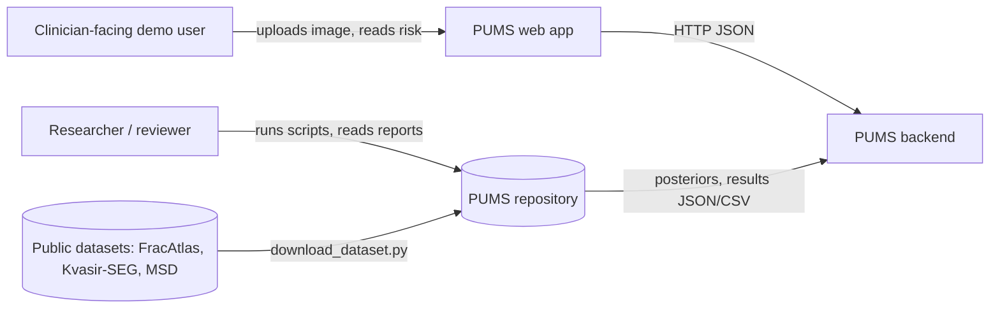
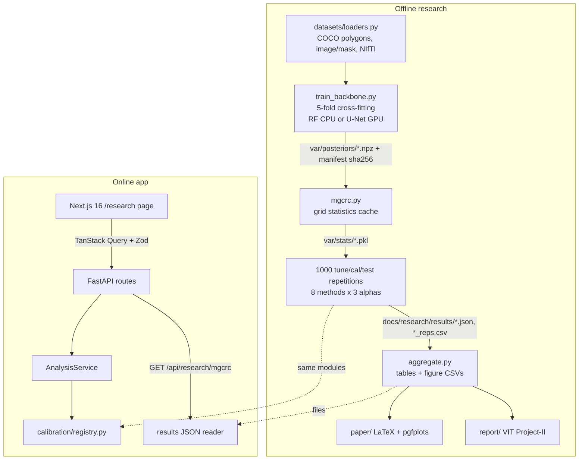
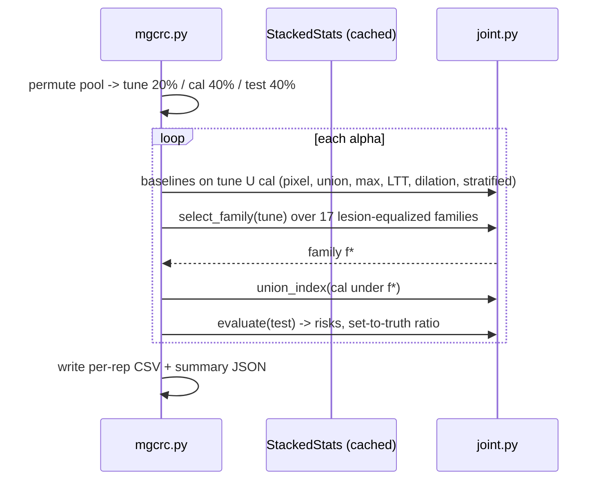
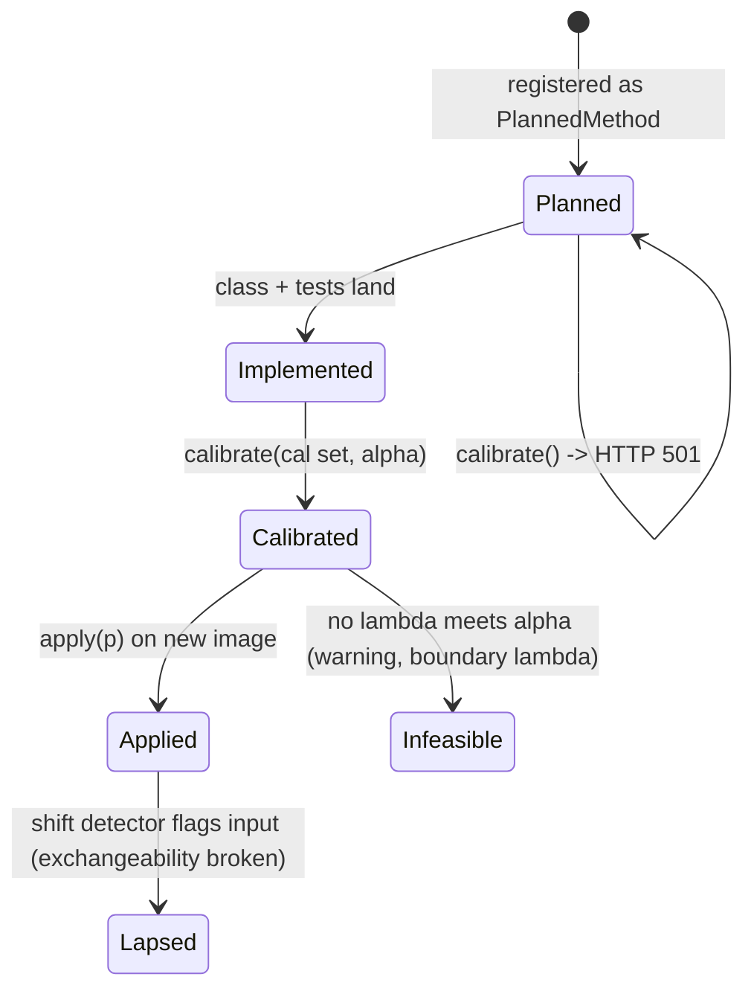
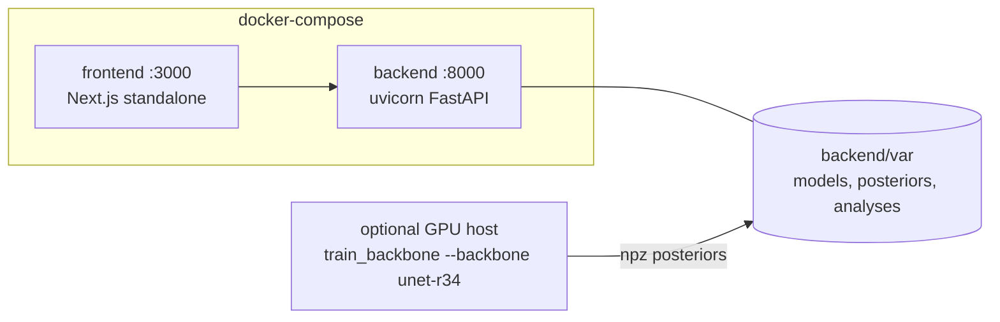

# PUMS — Architecture

**Perception Uncertainty Management System**
*A post-hoc hierarchical uncertainty calibration framework for dense medical
vision models under distribution shift.*

---

## 1. Design principles

Four rules shaped every decision in this codebase.

### 1.1 Uncertainty derives from real probabilities, always

The uncertainty map is a pure function of the model's own predictive
distribution. There is no place in the code where noise, smoothing, or a
"nice-looking" field is injected into the production path. This is enforced by a
test that recomputes entropy independently from the returned probabilities and
asserts an exact match (`backend/tests/test_uncertainty.py::test_uncertainty_derives_from_real_probabilities`).

### 1.2 The uncertainty stack depends on one array, not on a model

Every research layer consumes a `(C, H, W)` probability array and nothing else.
That single narrow contract is what makes the framework model-agnostic: an
adapter for nnU-Net, SegFormer, or SAM changes one class and nothing downstream.

### 1.3 Provenance and maturity travel with every number

Two enums are attached to results throughout the system and are rendered by the
UI:

- `ImplementationStatus` — `implemented` / `baseline` / `experimental` / `planned`
- `DataProvenance` — `computed` / `synthetic` / `mock`

A method whose status is `planned` raises on invocation and returns HTTP 501.
The UI reads the backend registry, so it is structurally incapable of offering a
method the backend does not implement.

### 1.4 No magic numbers in research code

Every constant that influences a reported result lives in
`backend/app/core/config.py` with a comment stating how it was chosen. The
distribution-shift thresholds are derived by a committed script
(`backend/scripts/calibrate_shift_thresholds.py`) rather than guessed, and the
risk score is the exact sum of itemised, self-describing factors — verified by a
test.

---

## 2. System overview

```
┌────────────────────────── frontend (Next.js 16, React 19) ──────────────────────────┐
│  app/            App Router pages (9 routes)                                        │
│  features/       Page-specific composites (analyze, results)                        │
│  components/     Shared UI, viewer, charts, research badges                         │
│  hooks/          TanStack Query hooks — all server state                            │
│  stores/         Zustand — client state only (viewer settings, config)              │
│  lib/api/        Centralised client + Zod runtime validation                        │
└───────────────────────────────────┬─────────────────────────────────────────────────┘
                                    │ HTTP + JSON (snake_case), PNG for dense maps
┌───────────────────────────────────▼─────────────────────────────────────────────────┐
│                          backend (FastAPI, Python 3.11+)                            │
│                                                                                     │
│  api/routes/  ──►  services/analysis_service.py  ──►  the research modules below    │
│                    (the single orchestrator)                                        │
│                                                                                     │
│  preprocessing/ │ models/ │ uncertainty/ │ calibration/ │ shift/ │ risk/ │ evaluation/│
└─────────────────────────────────────────────────────────────────────────────────────┘
```

---

## 3. The vertical slice

```
            uploaded bytes
                  │
     ┌────────────▼────────────┐  preprocessing/pipeline.py
     │  PreprocessingPipeline  │  validate → load → grayscale → normalise
     │                         │  → resize 256×256 → intensity statistics
     └────────────┬────────────┘
                  │ PreprocessedImage
     ┌────────────▼────────────┐  models/registry.py → models/adapters/*
     │   BaseMedicalModel      │  predict_segmentation() → (C, H, W) probabilities
     └────────────┬────────────┘
                  │ SegmentationOutput
     ┌────────────▼────────────┐  uncertainty/estimators.py
     │  Uncertainty estimator  │  H(x) / log C  →  dense map in [0, 1]
     └────────────┬────────────┘
                  │ UncertaintyMap
     ┌────────────▼────────────┐  uncertainty/hierarchical.py
     │  Hierarchical engine    │  L3 pixel → L2 regions → L1 global
     └────────────┬────────────┘
                  │
        ┌─────────┴──────────┐
        ▼                    ▼
 calibration/          shift/detector.py
 conformal.py          composite intensity-domain score
 temperature.py                │
        └─────────┬────────────┘
                  ▼
        risk/engine.py — weighted, itemised, override-capable
                  │
                  ▼
        AnalysisResponse (Pydantic) + PNG media
                  │
                  ▼
        Next.js: decode PNG → Float32Array → threshold, colour-map, inspect
```

---

## 4. Backend modules

### 4.1 `preprocessing/`

`PreprocessingPipeline` is the only path from bytes to arrays. No route does
image work.

Notable decisions:

- **Format sniffing over MIME trust.** DICOM is detected by the `DICM` magic
  bytes at offset 128, because browsers frequently send DICOM as
  `application/octet-stream` or with no type at all.
- **Two normalisation strategies.** Ordinary 8-bit images are divided by 255 so
  their appearance is preserved exactly. DICOM and high-dynamic-range data use
  robust 1st/99th-percentile scaling, because medical modalities have arbitrary
  intensity ranges and a handful of extreme voxels would otherwise crush the
  histogram.
- **Degenerate-input guards.** `safe_moments()` returns `(0, 0)` for constant
  images. Without it, `scipy.stats.skew` divides by a zero standard deviation,
  yields NaN, and silently poisons the shift score — this was a real bug caught
  during development by a controlled-corruption test.

### 4.2 `models/`

`BaseMedicalModel` requires exactly one method: `predict_segmentation`.
Adapters additionally *declare* which of their channels constitute foreground
(`foreground_channels`), because only the adapter knows how its classes map to
the binary reduction the calibration layer needs.

| Adapter | Status | What it actually is |
| --- | --- | --- |
| `intensity-mixture-seg-v1` (default) | `baseline` | Per-image Gaussian mixture over intensity, local mean and local contrast, with a Potts MRF prior. Genuine posteriors, no pretrained weights, no downloads. |
| `region-proposal-det-v1` | `baseline` | Connected components of the segmentation, reported as boxes with their true mean class posterior. **Not a learned detector.** |
| `deeplabv3-resnet50-voc` | `experimental` | Real pretrained CNN, present to demonstrate model-agnosticism. Trained on **natural images**; no medical validity. Optional (`requirements-torch.txt`). |

**Why a classical model is the default.** The framework is about uncertainty,
not about segmentation accuracy. A per-image mixture gives real posteriors with
zero weight downloads and no fabricated clinical predictions, so the entire
research stack can be exercised and tested honestly on any machine.

**A finding worth recording.** The MRF-amplified mixture initially produced
posteriors saturated to 0/1 at float precision. Entropy was then ~0 almost
everywhere and *every* conformal threshold behaved identically — the calibration
layer was degenerate. The fix was to expose the mixture's log-responsibilities
explicitly and apply a temperature (`T = 4.0`) before the softmax. This is
disclosed as a model parameter in the adapter's descriptor, not applied silently
to results.

### 4.3 `uncertainty/`

Estimators implement `estimate(probabilities) -> UncertaintyMap`.

**Normalised predictive entropy** is the default:

$$\tilde H(x) = \frac{-\sum_c p_c(x)\log p_c(x)}{\log C} \in [0,1]$$

Dividing by `log C` is what lets a 4-class adapter and a 21-class adapter share
one colour scale — necessary for a model-agnostic framework, and unit-tested.
Also implemented: top-2 margin and least-confidence.

**Hierarchy.** One dense field is computed once; Levels 2 and 1 are strict
aggregations of it. Cross-level consistency is therefore structural, not
reconciled after the fact — which is the proposal's "unified hierarchical
framework" claim, made good in code.

| Level | Content | Derivation |
| --- | --- | --- |
| 3 · pixel | `uncertainty_map[y][x] ∈ [0,1]` | Directly from posteriors |
| 2 · object | Connected components of the high-uncertainty mask, **or** real detections | Aggregation of L3 within a region |
| 1 · global | Mean, percentiles, boundary vs interior split | Aggregation of L3 over the image |

The boundary/interior split is a genuine diagnostic: a working uncertainty map
must be more uncertain at class boundaries than in interiors, and a test asserts
this on real model output.

### 4.4 `calibration/`

**Split Conformal Risk Control** (Angelopoulos et al., ICLR 2024) is implemented
in full. For prediction sets $S_\lambda(X)=\{u:\hat p(u)\ge 1-\lambda\}$ and the
monotone false-negative-rate loss, PUMS selects

$$\hat\lambda=\inf\left\{\lambda:\frac{n\hat R_n(\lambda)+B}{n+1}\le\alpha\right\}$$

The `+B/(n+1)` term is what makes the bound valid at finite *n*. A test asserts
CRC never selects a smaller λ than the uncorrected empirical baseline — the
conformal correction's effect is demonstrated, not asserted.

**Temperature scaling** is also implemented, with one deliberate departure from
Guo et al.: it minimises **ECE rather than NLL**. On this model the objectives
genuinely disagree (NLL selects T ≈ 2.2, which makes measured ECE *worse*;
ECE is minimised near T ≈ 0.8). Since ECE is the quantity PUMS reports and the
risk engine consumes, optimising NLL and then displaying a degraded ECE would be
incoherent. Both objectives are available; the departure is documented in the
function's docstring.

**Honesty boundary.** The shipped calibration set is synthetic phantoms. The
*algorithm* is real and correctly implemented; the *data* is synthetic. Results
are therefore tagged `provenance: synthetic` everywhere, and when the shift
detector flags an input, the response gains an explicit warning that
exchangeability — and therefore the guarantee — no longer holds.

Planned methods (adaptive CRC, SACP, localized risk control, morphological
conformal, evidential) exist as registry entries that raise on invocation.

### 4.5 `shift/`

A composite of four interpretable indicators against a reference profile:

| Indicator | Weight | Why |
| --- | --- | --- |
| Wasserstein-1 on intensity histograms | 0.35 | Sensitive to *how far* mass moved, which is what a protocol change does |
| Jensen–Shannon distance | 0.30 | Bounded, symmetric; catches new modes that leave the mean intact |
| Standardised moment deviation | 0.20 | Distance in units the reference set itself defines |
| Edge-density deviation | 0.15 | Proxy for resolution / reconstruction kernel |

Band thresholds (0.42 / 0.50 / 0.78) were **measured**, not chosen: in-distribution
phantoms score p50 = 0.24, p95 = 0.39, p99 = 0.42, while controlled corruption
starts at 0.57 and full inversion averages 0.82.

**Stated limitation:** this is an input-space detector. It catches modality,
exposure and scanner changes; it will *not* catch semantic shift that preserves
intensity statistics. `confidence_degradation` and `uncertainty_increase` are
heuristic couplings of the score, explicitly **not** measured performance drops.

### 4.6 `risk/`

The score is a weighted sum of four normalised factors, each returned as a
`RiskFactor` carrying its raw value, normalisation, weight, contribution and a
plain-language rationale. The weights and thresholds are echoed in the response,
so any result can be recomputed by hand.

Two normalisations are non-obvious and therefore documented in code: confidence
is rescaled from the achievable range `[0.5, 1]` (a binary model cannot go
below 0.5, so naive scaling would give a perfectly confident model a 0.5
penalty), and ECE saturates at 0.20 (severe miscalibration) rather than the
theoretical maximum of 1.

Three override rules force `REVIEW_REQUIRED` regardless of the weighted score:
large high-uncertainty area, any single region above 0.85 peak uncertainty (so
a small critical lesion is not averaged away), and severe distribution shift
(which invalidates the calibration guarantee).

### 4.7 Data transport

A 256×256 float32 map is ~1.5 MB as JSON and ~15 kB as a grayscale PNG. PUMS
sends PNGs and the browser decodes them back to a `Float32Array`
(`value / 255`), so the client holds **real numbers** and the threshold slider
genuinely re-partitions data rather than adjusting a CSS filter.

An end-to-end test decodes the served PNG and asserts its mean matches the
reported Level-1 score to quantisation precision — proof the picture *is* the
data.

Segmentation masks use run-length encoding: lossless, exactly invertible, and
50–500× smaller than a raw array for typical masks.

---

## 5. Frontend architecture

**State split.** TanStack Query owns all server state; Zustand owns only what
the *user* is doing (viewer layers, analysis configuration, selection). The
Zustand store persists preferences but deliberately **not** the analysis payload
— that is server data, refetched by id, and persisting it would risk showing a
stale result.

**Runtime validation.** Every response passes through a Zod schema before
reaching a component. TypeScript types vanish at runtime; contract drift would
otherwise surface as a confusing render error deep in a component. Because
several fields carry research-integrity meaning (`provenance`, `status`,
`assumptions`), silently dropping them would misrepresent results — so the
boundary check is a correctness feature, not just ergonomics.

**No silent mock fallback.** When the backend is unreachable the UI shows an
explicit "Backend unavailable" state with the command to start it. It never
substitutes fabricated data.

---

## 6. Testing

| Suite | Count | Focus |
| --- | --- | --- |
| `backend/tests/` (pytest) | 93 | Preprocessing, uncertainty, calibration, shift, risk, evaluation, API |
| `frontend/tests/` (`node --test`) | 25 | PNG decode round-trip, colour ramp, formatting, **live contract fixture** |

Tests worth singling out:

- `test_uncertainty_derives_from_real_probabilities` — the integrity guarantee.
- `test_finite_sample_correction_is_conservative` — proves the conformal
  correction does what the theorem says.
- `test_loss_curve_is_monotone_non_increasing` — verifies the CRC precondition
  actually holds for our loss, rather than assuming it.
- `test_risk_score_equals_sum_of_declared_contributions` — no hidden terms.
- `test_uncertainty_png_round_trips_to_the_reported_mean` — the transport is lossless enough.
- `contract.test.mts` — validates a **real captured backend response** against
  the frontend Zod schemas, catching cross-language drift.

---

## 7. Known limitations

1. No medical data, no medical model, no clinical validation.
2. Conformal guarantees are marginal and require exchangeability; they lapse
   under exactly the distribution shift this project targets. PUMS detects and
   reports this but does not yet *restore* validity — that is the core research
   gap remaining.
3. Object-level uncertainty is region-derived unless a detection adapter runs;
   there is no trained detector.
4. Per-region "calibrated risk" is a combination of calibrated empirical risk
   with region uncertainty, **not** a region-conditional guarantee.
5. 2-D only. Multi-frame DICOM takes the middle slice.
6. Single-process, in-memory/JSON storage. No auth, no database, no multi-user.

---

## 10. Research pipeline — lesion-aware joint CRC (MG-CRC)

Added with the Project-II research line. Everything in this section is used to
produce the paper's numbers. The same calibration modules also serve the API.

### 10.1 Context (C4 level 1)



### 10.2 Containers (C4 level 2)



### 10.3 Components of the calibration layer (C4 level 3)

```mermaid
flowchart LR
  F[families.py<br/>threshold / dilation / lesion_equalized<br/>s = T(p), sets {s >= 1-lambda}] --> U[losses.py<br/>unit_stats: Lemma 2 order statistics<br/>stack: N x G loss matrices]
  U --> J[joint.py<br/>crc_index, union_index, max_index,<br/>ltt_index (HB p-values), stratified_indices,<br/>select_family, evaluate]
  J --> M[lesion_crc.py<br/>StructuredConformalRiskControl<br/>BaseCalibrationMethod adapter]
  M --> REG[registry.py<br/>lesion_aware_crc, morphological_conformal]
  C0[conformal.py<br/>pixel CRC - unchanged] --> REG
```

### 10.4 Sequence of one experiment repetition



### 10.5 Calibration-method state machine



### 10.6 Data lifecycle and reproducibility

| Stage | Artefact | Integrity |
|---|---|---|
| raw | `data/raw/*.zip/tar` (gitignored) | licence printed + accepted by `download_dataset.py` |
| loaded | `Slice2D` / volumes in memory | components labelled at native resolution |
| posteriors | `backend/var/posteriors/<ds>/<backbone>_seed<k>.npz` | sha256 + env in sibling `.json` manifest |
| statistics | `backend/var/stats/*.pkl` | deterministic function of posteriors + grid + τ |
| results | `docs/research/results/*.json`, `*_reps.csv` (committed) | seeds fixed; regenerated by `scripts/reproduce.*` |
| claims | `docs/research/results/summary.md`, paper | generated by `aggregate.py`; never typed by hand |

### 10.7 Deployment topology



The research pipeline needs no GPU (RF backbone, CPU). A GPU only shortens
backbone training, and the calibration layer itself is CPU-only and runs in
seconds once statistics are cached.
